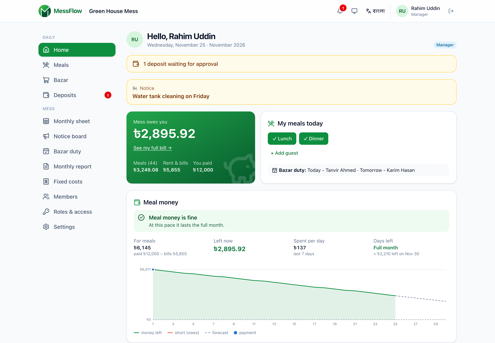
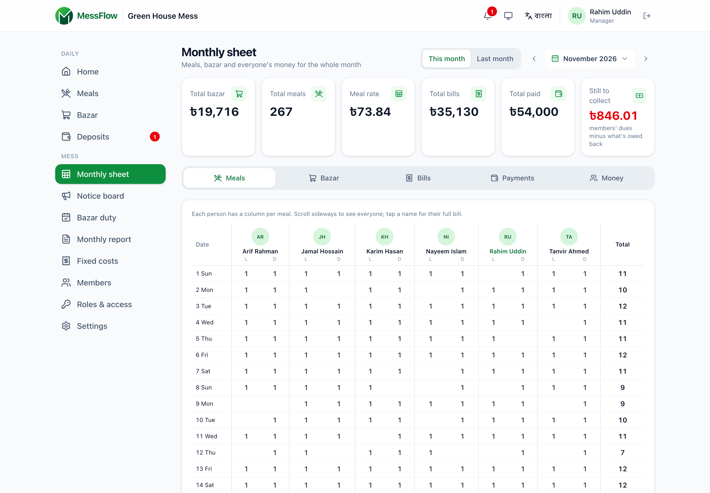
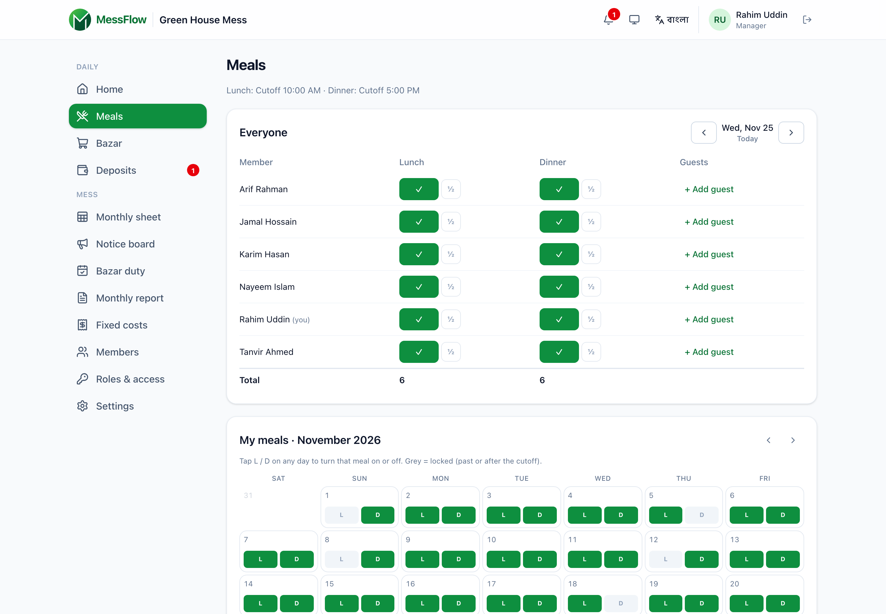
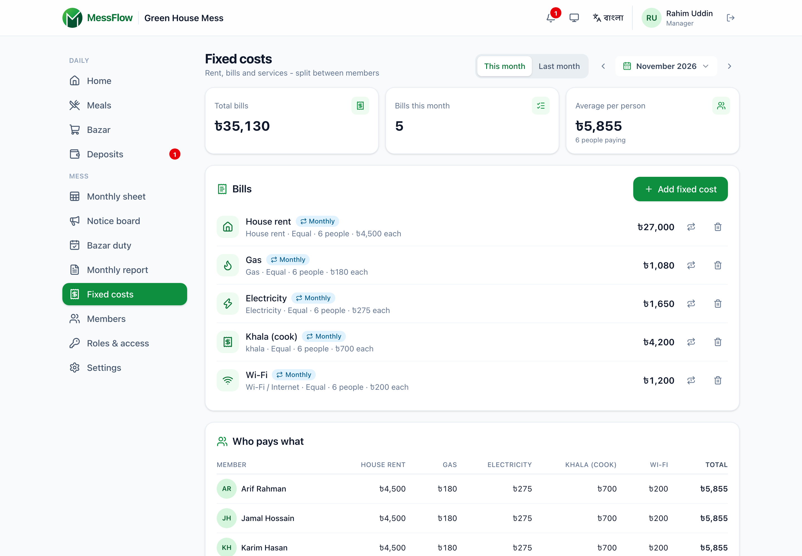
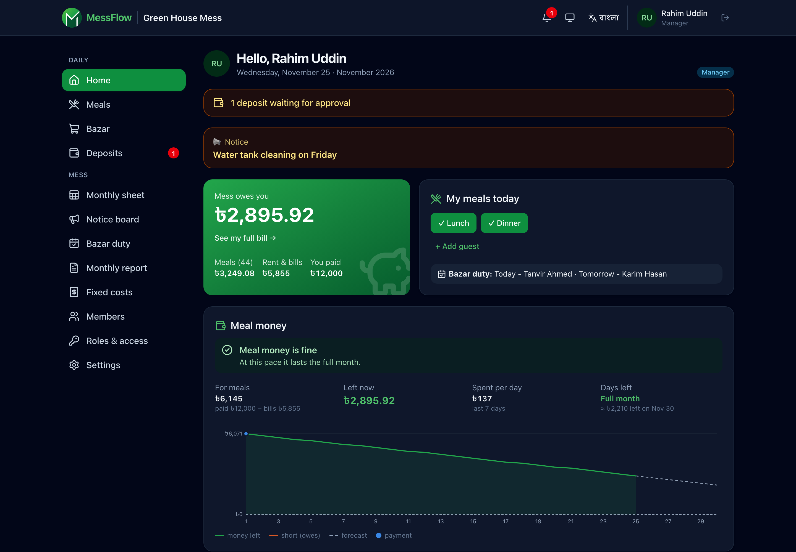
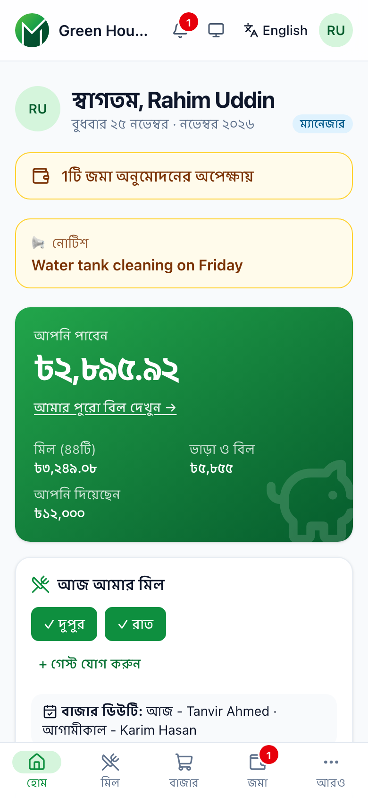
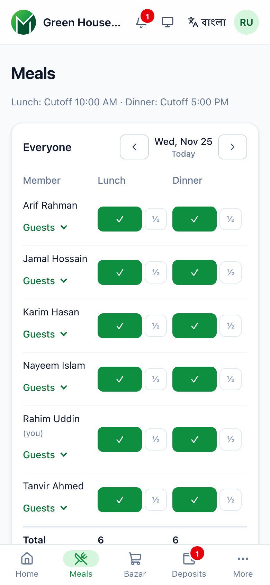
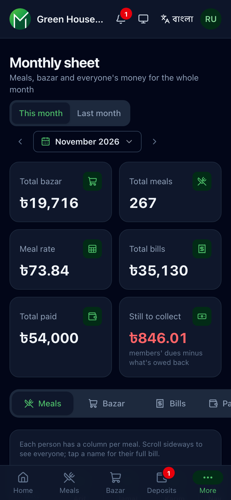

<div align="center">


# MessFlow · মেসফ্লো

**Mess management for bachelor messes in Bangladesh.**
Meals, bazar, bills, deposits and balances in one place, in Bangla and English.


[](LICENSE)

</div>

---

MessFlow replaces the shared Excel sheet a mess manager keeps every month. Meals are added automatically each
day, members turn their own meals on or off before the cutoff, and everyone sees a live meal rate and their own
balance. At month end the manager closes the month and every balance carries into the next one.

It runs as a website and installs on Android and iPhone like an app (PWA), with push notifications. It is
designed to run entirely on free tiers (Vercel + Supabase).

<p align="center">
  
</p>

## Contents

- [Screenshots](#screenshots)
- [Features](#features)
- [How the money works](#how-the-money-works)
- [Roles and permissions](#roles-and-permissions)
- [Tech stack](#tech-stack)
- [Getting started (local)](#getting-started-local)
- [Deploying (free)](#deploying-free)
- [Notifications and scheduled jobs](#notifications-and-scheduled-jobs)
- [Installing on phones](#installing-on-phones)
- [Project structure](#project-structure)
- [Scripts](#scripts)
- [Testing](#testing)

## Screenshots

| Monthly sheet | Meals |
|---|---|
|  |  |
| **Fixed costs** | **Dark mode** |
|  |  |

<p align="center">
  
  &nbsp;
  
  &nbsp;
  
</p>
<p align="center"><sub>On a phone: Bangla dashboard, meals, and the monthly sheet in dark mode. All names in the screenshots are made up.</sub></p>

## Features

**Meals**
- Daily meals created automatically from each member's default meals (breakfast, lunch, dinner)
- Members turn meals on or off before a configurable cutoff; managers can change anything
- Half meals and guest meals, with a month calendar view
- Daily menu ("what to cook") written by the manager and shown to everyone

**Money**
- Bazar entries, with the meal rate calculated from bazar only
- Fixed costs (rent, gas, electricity, khala, internet…) split equally or with custom shares
- Bills that repeat every month, and a choice of which bills a member joining mid-month pays
- Deposits by cash, bKash or Nagad, with approval
- Live balance per person, with dues and credits carried into the next month
- **Meal money tracker**: how long each member's paid money will last, with a chart, warnings and a suggested amount to pay

**Monthly sheet**
- A full-month view like a spreadsheet: Meals, Bazar, Bills, Payments and Money tabs
- Any past month or year can be opened, and a person-by-person breakdown is available
- Close and reopen months
- Monthly report: print or save as PDF, or download a CSV that opens in Excel (Bangla included)

**Mess life**
- Bazar duty roster: weekly schedule or rotation, swaps, done/missed tracking
- Notice board
- Push notifications plus an in-app notification inbox
- Due reminders with a custom note

**Administration**
- Super admin panel: approve new messes, create managers, see every mess and user
- Approval-based sign up: managers approve join requests
- Managers create members with temporary passwords, which members change at first login
- Cook (khala) login: one view-only kitchen page with today's meal counts and menu. Not a member, so no meals or bills
- Khala's leave: the manager marks a meal or full day, it goes off for everyone, and a member can offer "I'll cook" for the manager to approve
- Custom roles with per-area permissions (for example a *Cashier* who handles deposits only)
- Per-mess settings: cutoffs, meal-rate rounding, warning days, reminder times, new-member defaults

**Experience**
- Bangla (default) and English
- Light, dark and system themes
- Profile photos
- Undo for deletes
- Setup checklist for new managers
- Installable PWA with offline shell

## How the money works

```
meal rate   = total bazar ÷ total meals                (half meal = 0.5)
meal cost   = your meals × meal rate
balance     = carried in + deposits − meal cost − your share of fixed costs
```

- A positive balance means the mess owes you money; a negative balance is a due.
- **Close month** freezes every bill and carries each balance into the next month. Nothing is deleted, and a closed month can be reopened.
- **Meal-rate rounding** (Settings): *Exact* uses the full-precision rate. *Rounded* rounds the rate to 2 decimals first, which matches most hand-kept Excel sheets.

## Roles and permissions

| Role | How they get access | What they can do |
|---|---|---|
| **Super admin** | `pnpm admin:create` | Every mess and user: approve messes, create managers, open any mess, reset passwords, block accounts |
| **Manager** | Created by the super admin, or a new-mess request the super admin approves | Everything in their mess, including custom roles and settings |
| **Custom role** | Given by the manager | Only the ticked permissions: meals, bazar, deposits, fixed costs, members, bazar duty, notices, close month, settings |
| **Member** | Added by the manager, or invite code + approval | Own meals and guests before the cutoff, submit payments, view the mess's numbers |

New sign-ups can do nothing until they are approved: by the super admin for a new mess, or by the manager for a join request.

## Tech stack

| Layer | Technology |
|---|---|
| Framework | [Next.js 15](https://nextjs.org) (App Router, Server Actions), React 19 |
| Database and auth | [Supabase](https://supabase.com): Postgres, Row Level Security, `pg_cron`, Storage |
| Styling | [Tailwind CSS 4](https://tailwindcss.com), [lucide-react](https://lucide.dev) icons |
| Languages | [next-intl](https://next-intl.dev) (`bn`, `en`) |
| Notifications | Web Push (VAPID) via [`web-push`](https://github.com/web-push-libs/web-push) |
| Hosting | [Vercel](https://vercel.com) (Singapore region) |

All business rules (meal generation, balances, month closing, permissions) live in Postgres functions protected
by Row Level Security, so the data stays consistent no matter which client writes it.

## Getting started (local)

**Requirements:** Node.js 20+, [pnpm](https://pnpm.io), and a free Supabase project.

```bash
git clone <your-fork-url> messflow
cd messflow
pnpm install
cp .env.example .env.local   # then fill in the values (see below)
pnpm db:migrate              # applies supabase/migrations to your database
pnpm admin:create            # creates your super admin login
pnpm dev                     # http://localhost:3000
```

### Environment variables

| Name | Where to find it |
|---|---|
| `NEXT_PUBLIC_SUPABASE_URL` | Supabase → Project Settings → API → Project URL |
| `NEXT_PUBLIC_SUPABASE_PUBLISHABLE_KEY` | Same page: publishable (anon) key |
| `SUPABASE_SECRET_KEY` | Same page: secret (service_role) key. **Server only, never expose it** |
| `DATABASE_URL` | Supabase → Connect → Session pooler URI. Only used by `pnpm db:migrate` on your machine |
| `CRON_SECRET` | Any long random string |
| `NEXT_PUBLIC_VAPID_PUBLIC_KEY`, `VAPID_PRIVATE_KEY` | `npx web-push generate-vapid-keys` |
| `VAPID_SUBJECT` | `mailto:` followed by your email |

## Deploying (free)

### 1. Supabase
1. Create a project at [supabase.com](https://supabase.com), region **Singapore** (closest to Bangladesh).
2. Apply the schema with `pnpm db:migrate`. Alternatively, run every file in `supabase/migrations/` **in filename order** in the SQL Editor, or use `supabase db push`.
3. **Authentication → Sign In / Providers → Email:** turn off *Confirm email*. The free email service only sends a few emails per hour, and members are approved inside the app anyway.

### 2. Vercel
1. Import this repository at [vercel.com/new](https://vercel.com/new).
2. Add every environment variable above **except** `DATABASE_URL`.
3. Deploy. `vercel.json` already sets the Singapore region (`sin1`) and the daily cron job.

### 3. Connect the two
1. **Supabase → Authentication → URL Configuration:** set *Site URL* to your Vercel URL and add `https://YOUR-APP.vercel.app/**` to *Redirect URLs*.
2. **Supabase → SQL Editor:** enable the 10-minute scheduled jobs with your app URL and the same `CRON_SECRET`:
   ```sql
   insert into private.config (key, value) values
     ('notify_url',  'https://YOUR-APP.vercel.app/api/cron/notify'),
     ('cron_secret', 'YOUR-CRON-SECRET');
   ```
3. Create your super admin with `pnpm admin:create` (run locally against the same database), log in, and create your first mess and manager from the Admin panel.

## Notifications and scheduled jobs

| Job | Runs | Does |
|---|---|---|
| `pg_cron` daily meals | 00:05 Dhaka | Creates each active member's meals for the day |
| Vercel cron `/api/cron/daily` | 00:10 Dhaka | Backup for the above; also keeps the free Supabase project from pausing |
| `pg_cron` → `/api/cron/notify` | Every 10 minutes | Reminders below, weekly bazar duty, repeating bills for the new month |

Reminders (times and on/off are set per mess in **Settings**):

| Notification | Sent to |
|---|---|
| Meal cutoff reminder (30, 45 or 60 minutes before) | Every member |
| Bazar duty, the evening before | Members on duty |
| Weekly dues reminder, or **Send due reminders** with a note | Members who owe money |
| Meal money almost finished / finished | That member and people who collect deposits |
| Deposit submitted, approved or rejected | Collectors / that member |
| New notice, duty swap, approval requests | The people concerned |

Each member turns notifications on once per device under **More → Notifications**. Every notification is also kept in the in-app bell inbox.

## Installing on phones

| Platform | Steps |
|---|---|
| Android (Chrome) | Open the site → ⋮ → **Install app** |
| iPhone (Safari) | Share → **Add to Home Screen** (push needs iOS 16.4+ and opening from the Home Screen) |
| Android APK | Paste your deployed URL into [PWABuilder](https://www.pwabuilder.com) → Android to generate an `.apk` / `.aab` |

## Project structure

```
messages/{bn,en}.json     All UI text. Edit here to change wording
public/sw.js              Service worker: install, offline shell, push
scripts/                  migrate, create super admin, reset data, database tests
src/app/[locale]/(app)/   Mess pages: dashboard, meals, sheet, bazar, deposits, costs, members, roster, notices, report, settings
src/app/[locale]/admin/   Super admin panel
src/app/api/cron/         Daily and 10-minute scheduled endpoints
src/components/           UI components (forms, dialogs, charts, meal toggles…)
src/lib/actions/          Server actions (all writes)
src/lib/                  Supabase clients, queries, dates, meal money, push and notification logic
supabase/migrations/      Schema, RLS policies, Postgres functions, cron jobs
```

## Scripts

| Command | Description |
|---|---|
| `pnpm dev` | Start the development server |
| `pnpm build` / `pnpm start` | Production build and server |
| `pnpm lint` | ESLint |
| `pnpm test:db` | Database tests in an in-memory Postgres (PGlite). No Docker or Supabase needed |
| `pnpm db:migrate` | Apply new migrations to the database in `DATABASE_URL` |
| `pnpm admin:create` | Create or promote the super admin |
| `pnpm db:migrate:prod` / `pnpm admin:create:prod` | Same, using `.env.production.local` (your live project) |
| `pnpm db:reset-data` | Delete all mess data, keeping the super admin (asks for confirmation) |

## Testing

`pnpm test:db` runs the database test suite against an in-memory Postgres. It covers meal generation, cutoffs,
balances, month closing, permissions and Row Level Security.

## License

[MIT](LICENSE). Free to use, change and share, with credit.

---

<div align="center">
Made for messes in Dhaka 🇧🇩
</div>
